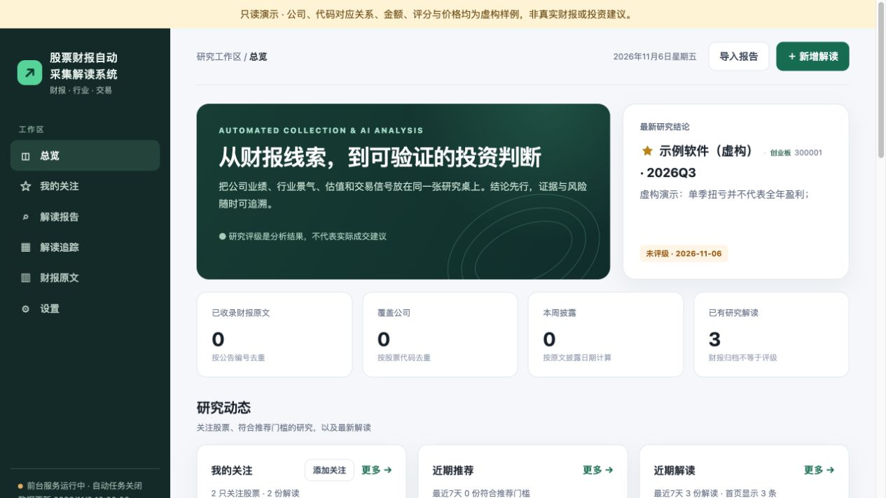
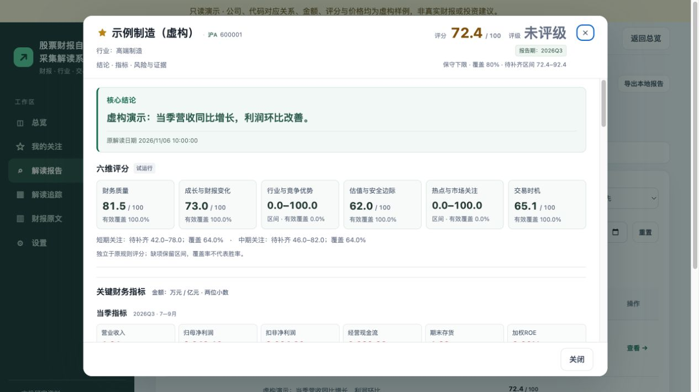
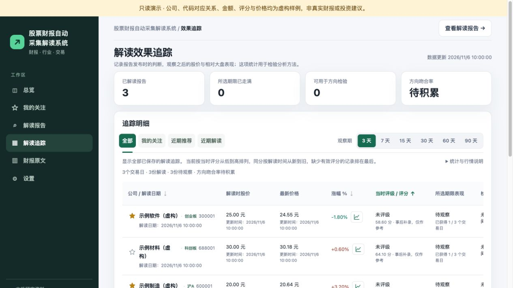

# 股票财报自动采集解读系统 · stock-report

**English: stock-report**  
Automated Collection & AI Analysis · 建议仓库名：`stock-report`

本地运行的 A 股财报研究工具：采集公开财报，提取并核对财务指标，生成带证据的解读，并追踪解读后的价格变化。

**本地 SQLite 为主；不需要安装 Obsidian。** 报告同时可保存为 Markdown，供 Obsidian 或其他编辑器阅读。项目没有附带任何真实密钥、个人关注清单、数据库、历史账单或对话记录。



## 能做什么

- 财报采集、下载与本地文字提取，记录来源和页码；支持年报、半年报、一季报和三季报。
- 展示当季、上季、年度累计指标；区分同比、环比、扭亏、减亏与亏损扩大。
- 规则评分与六维研究分别展示；覆盖不足保留未知区间，不当作完整评分或上涨概率。
- 支持模型配置、用途与备用顺序、单份预估费用上限和每日调用上限。
- 解读追踪支持涨幅、冻结评分升降序排序，以及报告弹窗和走势图。
- 关注列表、报告检索、来源核对、Markdown 归档。

**不包含实盘交易或自动下单。** 评分与推荐筛选尚未完成全市场样本外验证。报告生成和公开数据的可用性依赖外部服务；示例不代表真实公司或收益。

## 五分钟体验：不需要密钥

需要 Python 3.12。先从本仓库下载源码并进入项目目录：

```sh
python3 tools/serve.py --demo
```

打开终端显示的 `http://127.0.0.1:8876/`。演示为只读，使用虚构公司、价格、评分与证据；不会调用模型、抓取行情、创建数据库或安装启动项。停止请按 `Ctrl+C`。端口占用时添加 `--port 18876`。

## 使用自己的数据

```sh
python3 -m venv .venv
source .venv/bin/activate
python -m pip install -r research-data/requirements.lock
python tools/serve.py
```

进入“设置”，填入自己的模型密钥并读取可用模型，选择用途、保存并勾选启用。首次启动无模型、无关注股票、无历史数据；自动运行默认关闭。配置好后，点击“运行一次研究流程”。外部采集和付费调用从明确运行或启用自动任务后开始。

模型密钥可由设置页写入本地私密配置，也可使用 `.env.example` 创建 `.env.local`；不会返回到网页或进入示例。模型可用名称、价格和峰谷时段必须以服务商实际返回与账单为准。

前台模式下，自动任务只在服务进程运行期间执行。macOS 的系统任务安装是另行选择的操作，见[安装说明](docs/INSTALL.md)。首版在 macOS 上验证；Linux、Windows 的完整采集和调度流程尚未验证，不宣称全平台可用。

## 界面

| 解读报告：核心结论、六维研究和指标 | 解读追踪：排序与报告弹窗 |
| --- | --- |
|  |  |

演示截图由实际网页渲染获得，全部数据为明确标注的虚构样例。原有的“解读费用明细”和“新财季 Pro 精读”面板已从开源版设置页移除；通用费用上限仍可配置。

## 架构与文件

```text
stock-site/                 原生 HTML / CSS / JavaScript 前端
research-data/stock_research/ Python 后台：采集、核对、模型、评分、追踪
research-data/tests/        离线回归测试与公开财报格式样例
research-data/automation.example.json  全新默认配置
examples/demo-site/         虚构演示数据，与真实数据分离
tools/                     前台启动、检查、源码打包
docs/                      安装、架构、安全、贡献、验证记录
```

业务索引与结果存入 SQLite；原文、原始响应和部分任务收据仍用本地文件保存。首版没有把所有状态强行迁入数据库。具体职责、数据流与归档边界见[架构说明](docs/ARCHITECTURE.md)。

## 开发与测试

```sh
source .venv/bin/activate
PYTHONPATH=research-data python -m unittest discover -s research-data/tests -p 'test_*.py'
python tools/check_release.py
```

JavaScript 离线测试需要 Node.js，执行方法及本次实际结果见[验证记录](docs/VALIDATION.md)。常规测试不使用真实密钥、不调用付费模型；外部接口连通性需使用者自行验证。

- [安装与故障排查](docs/INSTALL.md)
- [配置字段](docs/CONFIGURATION.md)
- [架构与 SQLite / Markdown 分工](docs/ARCHITECTURE.md)
- [隐私与安全](SECURITY.md)
- [贡献指南](CONTRIBUTING.md)
- [第三方依赖与数据来源](THIRD_PARTY_NOTICES.md)
- [版本记录](CHANGELOG.md)
- [源码检查与 GitHub 发布步骤](docs/PUBLISH.md)

## 许可

源码采用 [MIT](LICENSE)。第三方依赖遵循各自许可证。公开财报、行情及第三方内容的使用与再分发条件独立于本项目许可证，本仓库没有打包真实财报或行情数据库。
