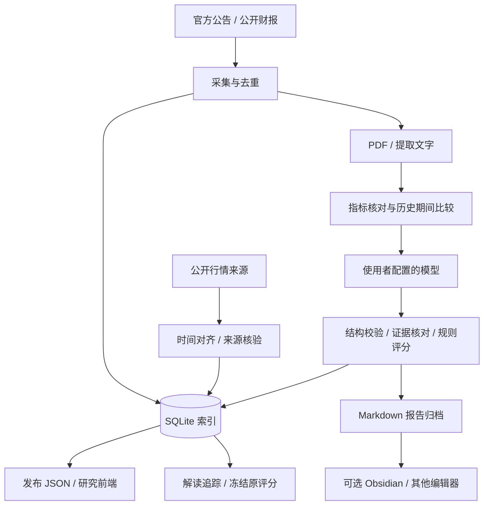

# 架构与存储

## 设计选择

以 SQLite 保存业务记录，以本地文件保存较大文档、可恢复收据和人类可读报告；Obsidian 只是可选阅读工具。服务只监听回环地址，前端与 API 同源，不要求 Apache、云数据库、浏览器自动化或额外监控程序。

## 存储职责

| 位置 | 内容 | 是否纳入开源源码 |
| --- | --- | --- |
| `research-data/db/automation.sqlite` | 公告索引、版本化解读、调用记录、缓存与运行记录 | 否 |
| `research-data/filings/`、`text/` | 下载原文与逐页提取结果 | 否 |
| `storage/archive/` | Markdown 报告、原始响应、队列控制、费用与恢复收据、归档清单 | 否 |
| `stock-site/data/`、`analysis/` | 真实运行后发布的网页数据 | 否，由本地运行生成 |
| `.env.local` | 使用者自己的模型密钥 | 否 |
| `research-data/automation.json` | 使用者的设置、模型引用和关注列表 | 否 |
| `examples/demo-site/` | 人工构造的虚构示例 | 是 |

“本地数据库为主”不等于所有文件都进数据库。任务控制及付费请求恢复收据目前仍是文件状态；仅备份 SQLite 不能完整恢复任务。完整备份应覆盖数据库、原文、归档及本地配置，密钥另行私密保管。运行中的数据库应使用 SQLite 备份接口或先停止本实例，不能只复制可能正在写入的主数据库文件。

## 模块边界

- `core.py`：路径、配置、SQLite、原子文件写入和本地密钥读取。
- `sources.py`、`disclosure_sources.py`：公告与 PDF；`financial_*`：期间、原表证据与比较。
- `models.py`、`model_endpoints.py`：模型传输、接口目的地址检查与备用顺序。
- `analysis.py`：模型结构要求、引文核对与报告生成。
- `scorecard.py`、`research_shadow.py`、`operating_catalysts.py`：规则与六维研究、经营催化。
- `tracking*.py`：冻结解读时点、行情刷新与观察期检验。
- `publish.py`：发布网页数据；`vault_archive.py`：本地归档与恢复校验。
- `service.py`、`tools/serve.py`：同源站点/API、前台任务与只读演示。

历史批次和高级恢复模块保留为内部组件，但开源包不携带任何特定财季队列，也不会首次启动即恢复原作者任务。设置页移除了专用批次与费用历史面板。

## 评分与证据

规则评分、六维研究和数据覆盖率不是同一个概念。缺失因子保留区间；覆盖率表示已取得且可用的因子权重，不代表准确率或交易胜率。新闻热点和行业判断要求独立来源，不能只靠模型措辞补齐。评分高低与短期涨跌的关系尚需持续收集样本、分组和样本外检验。

## 可选 Obsidian

不需要安装、启动或连接 Obsidian。需要阅读报告时，可以用任意 Markdown 编辑器打开本地归档。若把整个归档作为 Obsidian 库打开，其中也会包含私人状态与调用收据；共享时只选定已经审阅的报告文件，不能把整个运行归档当作公开文档上传。

## 当前边界

首版面向单机个人研究；没有多用户身份认证、服务端密钥保险库或公网部署方案。行情源可中断，交易日历与模型价目包含版本化静态规则，未来年份和新型号需维护；未核实信息不得被描述为实时准确。扫描 PDF 可能需要人工或另行配置 OCR，尚未内置自动 OCR 服务。
